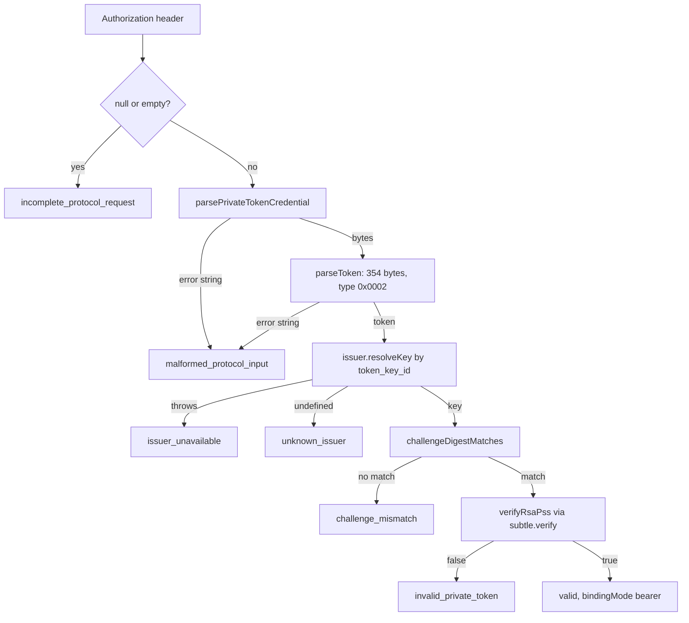
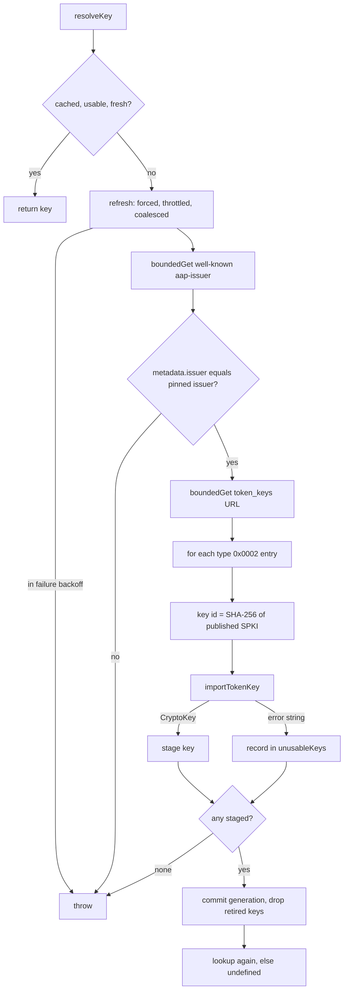
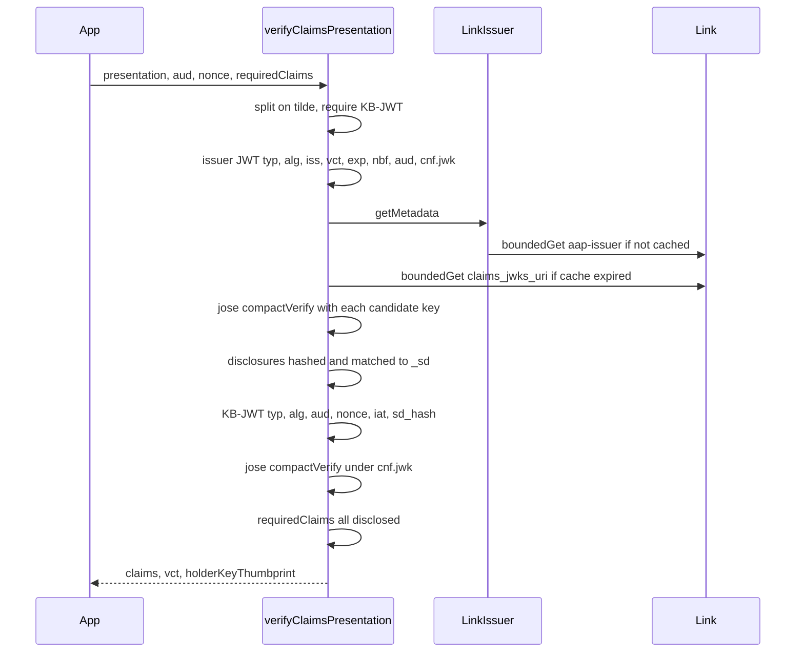
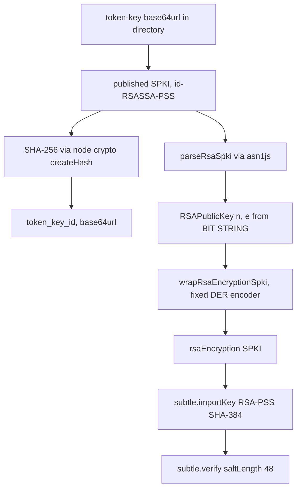

# Data flow: credential verification

How `@stripe/agent-identity` verifies the two credential types. Describes `src/` as written; no other behaviour is implied.

- Entry point: `LinkVerifier` (`src/verifier.ts`) wraps one `LinkIssuer` (`src/issuer.ts`), pinned to `https://api.link.com`.
- Results: `{ valid: true, ... }` or `{ valid: false, failures }`. `isRejection` (`src/index.ts`) treats every code except `issuer_unavailable` as "credential is bad" (401); `issuer_unavailable` means "could not tell" (503).

## 1. Attestation (AAT)

`verifyAttestation` (`src/index.ts`), in code order:

- `parsePrivateTokenCredential` (`src/attestation.ts`): max 8192 chars, no CR/LF, `PrivateToken` scheme, auth-params parsed by name, exactly one `token`, length cap, base64url charset.
- `parseToken`: exact size, `token_type` 0x0002; slices nonce, challenge digest, 32-byte key id, 256-byte authenticator; signed input = first 98 bytes.
- `challengeDigestMatches`: SHA-256 of the bearer `TokenChallenge` (Link host, empty redemption context, empty origin info), compared with `timingSafeEqual`. Key-bound tokens never match.
- Rejection messages get recovery guidance appended; `issuer_unavailable` does not.

### Token-key resolution

`LinkIssuer.resolveKey` -> `refresh` -> `fetchAndApplyDirectory` (`src/issuer.ts`):

- Any throw (fetch failure, bad metadata, no usable key, backoff) -> `issuer_unavailable`.
- Key id not in directory, or refused by `importTokenKey` -> `unknown_issuer`; `explainUnresolved` adds the refusal reason.
- Cache policy: `minRefreshSeconds` 300, `maxKeyAgeSeconds` 900, failure backoff 30 s, unknown-id refresh throttle 5 s, retired-key grace 0.
- `boundedGet` (`src/internal/http.ts`): https only, no URL credentials, no private/loopback/link-local/CGNAT hosts (incl. IPv4-mapped IPv6), same origin as issuer, `redirect: 'manual'` and any 3xx refused, deadline raced (default 3000 ms), body cap checked on `content-length` and while reading (default 256 KiB).

### importTokenKey (`src/internal/crypto.ts`)

1. `parseRsaSpki` (`src/internal/der.ts`): asn1js decode, strict DER (re-encode round trip, no indefinite length, minimal non-negative INTEGERs), max 8192 bytes, OID `rsaEncryption` or `id-RSASSA-PSS`, odd exponent >= 3.
2. Modulus >= 2048 bits.
3. PSS params (when declared): hash SHA-384, MGF1-SHA-384, salt 48. `readPssParams` already refuses omitted members and trailerField != 1.
4. `id-RSASSA-PSS` -> `wrapRsaEncryptionSpki(rsaPublicKey)`; `rsaEncryption` passes through.
5. `subtle.importKey('spki', ..., { name: 'RSA-PSS', hash: 'SHA-384' }, false, ['verify'])`.
- Verification: `subtle.verify({ name: 'RSA-PSS', saltLength: 48 })`; a throw counts as `false`.

## 2. Identity presentation (SD-JWT-VC + KB-JWT)

`LinkVerifier.verifyClaims` -> `verifyClaimsPresentation` (`src/claims.ts`). Every failure is `invalid_claims_presentation` except JWKS/metadata problems (`issuer_unavailable`) and a missing/non-string header (`incomplete_protocol_request` / `malformed_protocol_input`, in `verifier.ts`).

- Size: presentation <= 64 KiB.
- Issuer JWT: `typ` in `dc+sd-jwt`/`vc+sd-jwt`; `alg` EdDSA or ES256 only; `iss` equals pinned issuer; `exp` required, no skew; `nbf` no skew; plaintext `aud` must include ours; `cnf.jwk` required.
- JWKS: `resolveIssuerKeys`, module-level cache keyed by URI, TTL 3600 s, max 16 keys, filtered by `kid` (falls back to all), each imported via `importJwkForVerify` (kty/crv/alg/use/key_ops checks, no private `d`). Fetch via `boundedGet`, same origin as issuer.
- Signatures: `verifyJws` = jose `compactVerify` with one allowed alg; `b64: false` refused.
- Disclosures: `_sd_alg` sha-256 only; duplicate digests refused; each disclosure's SHA-256 must be in `_sd`; `[salt, name, value]` only; reserved names, plaintext collisions, duplicates and nested `_sd`/`...` (depth > 8 also refused) rejected.
- KB-JWT: `typ` `kb+jwt`; `aud` and `nonce` exact match; `iat` within 60 s; `sd_hash` = SHA-256 of the presentation bytes up to the last tilde.
- `requiredClaims` must be supplied (`[]` allowed); any missing claim fails.

## 3. Token-key bytes

- Key id is hashed over the bytes as published, never the re-wrapped copy (RFC 9578 6.5).
- Why the detour (`der.ts` header): Web Crypto imports RSA-PSS only from `rsaEncryption` SPKI ("Invalid SPKI input" in Workers); `jose.importSPKI` inherits that. Workers `nodejs_compat` `createPublicKey` rejects the key and `crypto.verify` refuses a `KeyObject`.
- Hashing stays on `node:crypto` `createHash` and base64 on `node:buffer`, which `nodejs_compat` supports.
- `boundedGet` calls `fetchImpl` unbound (Workers throws "Illegal invocation" otherwise) and uses `redirect: 'manual'` because Workers lacks `'error'`.

## 4. Trust boundaries

Untrusted inputs and where each is bounded:

- Authorization header: `attestation.ts:parsePrivateTokenCredential` (8 KiB, CR/LF, param parsing, base64url), `attestation.ts:parseToken` (exact length, type).
- token_key_id: `issuer.ts:resolveKey` and `refreshForUnrecognizedKey` (cache lookup; unknown ids refresh at most every 5 s; failure backoff; coalesced in-flight fetch).
- Issuer metadata and token-keys documents: `http.ts:boundedGet`/`checkFetchTarget` (origin, https, private hosts, redirects, size, time), `http.ts:parseJson`, `issuer.ts:fetchAndApplyDirectory` (issuer pinned, staged commit, per-entry refusal).
- Published SPKI: `der.ts:parseRsaSpki`/`readPssParams` (strict DER, 8 KiB), `crypto.ts:importTokenKey` (modulus, PSS params).
- Token authenticator: `crypto.ts:verifyRsaPss` (throw -> false).
- Identity-Presentation header: `verifier.ts:verifyClaims` (type), `claims.ts:verifyClaimsPresentation` (64 KiB, typed parsing before signature checks).
- Credential JWKS: `claims.ts:resolveIssuerKeys` (boundedGet, 16 keys, TTL), `crypto.ts:importJwkForVerify`.
- Holder key `cnf.jwk`: `crypto.ts:importJwkForVerify` (curve/alg match, public only).
